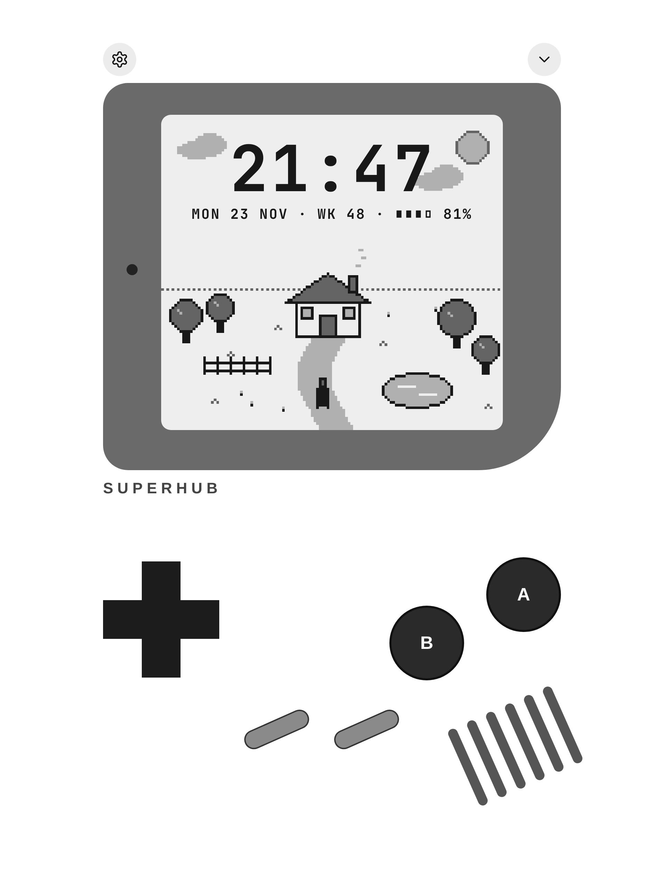
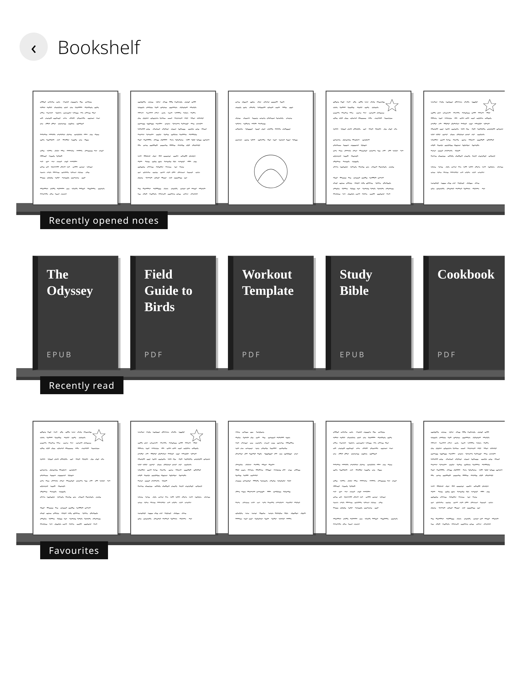

# SuperHub-v3

**SuperHub-v3** is a playful home screen for Supernote that looks like a retro handheld games console. The clock, date, week and battery sit in the sky of a little pixel-art screen, and the console's nine buttons are yours to point at anything.

SuperHub-v3 is based on [SuperDashboard](https://github.com/AgP42/SuperDashboard) by **AgP42**, used under the MIT licence. Thank you to AgP42 for the original plugin. It is a sibling of [SuperHub](https://github.com/weedwhitesandwine/SuperHub) and [SuperHub-v2](https://github.com/weedwhitesandwine/SuperHub-v2).

| | | |
|---|---|---|
|  |  |  |

## What it does

- **Console home screen** drawn on the plain page, with empty margins on all four sides so the Supernote's own bars stay clear.
- **Nine buttons**: the D-pad's four arms, two pill buttons, B, A and the speaker grille. Give each a name and point it at:
  - a folder, or a note or document
  - any app installed on your Supernote
  - a SuperHub page: Favourites, Starred pages, Keywords, Search, Note Clips, To-do, or the Bookshelf
  - a **new note** (choose its name, folder, page style, handwriting recognition and orientation) or a **new typed document**
  - today's notebook in a folder of dated notebooks (`YYYY/YYYY-MM-DD.note`)
- **Button names** beside each button, or hide them for just the console.
- **Bookshelf**: three shelves of up to five covers. Choose what each shelf shows: recently opened notes, recently read documents, favourites, or starred pages.
- The pixel-art scene is original.

## Install

You need Supernote firmware with plugin support: Chauvet **3.29.43 or later** on Manta and Nomad (2.26.40 or later on A5 X and A6 X). SuperHub-v3 was developed on a Manta with 3.31.45.

1. Download `SuperHub-v3.snplg` from [Releases](https://github.com/weedwhitesandwine/SuperHub-v3/releases/latest), or install it from InkHub once it is listed there.
2. Copy it into the **MyStyle** folder on your Supernote.
3. On the Supernote: **Settings → Apps → Plugins → Add Plugin**, and choose `SuperHub-v3.snplg`.

## Open it

1. Open any note. In the toolbar, tap the plugin button (the puzzle piece) and choose **SuperHub-v3**. Allow file access when asked.
2. From then on, tap the floating **house** on any screen to open it.
3. **Change the buttons**: tap the **cog** at the top left.
4. **Close it**: tap the button at the top right.

A fresh install starts with Favourites, Bookshelf, Starred pages and Digest on the D-pad, the Supernote's Settings app and Search on the pill buttons, Notes and New note on B and A, and Calendar on the speaker.

## Your settings

Saved as you change them, in `MyStyle/Plugins/SuperHub-v3/config.json`, with an automatic backup beside it. Updating or reinstalling keeps them, and you can keep named copies under **Saved copies of your settings**.

## Permissions

- **File read and write**: to list and open your notes and folders, show page previews, make new notes, and save settings.
- **No internet**: SuperHub-v3 works entirely on your Supernote.

## Build from source

```bash
./buildPlugin.sh                                   # -> build/outputs/SuperHub-v3.snplg
python3 icon-src/scene.py assets/hub/scene.png     # redraw the pixel-art scene (needs Pillow)
```

Needs Node 22, JDK 21 and the Android SDK (platform 35, build-tools 35.0.0, NDK 27.1, CMake 3.22). React Native is fixed at 0.79.2 to match the Supernote's plugin host.

## Licence

MIT. See [LICENSE](LICENSE). SuperHub-v3 keeps AgP42's SuperDashboard copyright notice alongside its own.
